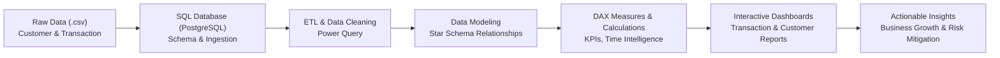

# 💳 Credit Card Financial Dashboard — Weekly Transaction & Customer Analytics

[](https://powerbi.microsoft.com/)
[](https://www.postgresql.org/)
[](https://learn.microsoft.com/en-us/dax/)
[](https://en.wikipedia.org/wiki/SQL)
[]()

---

## 📌 Project Objective

> **"To develop a comprehensive credit card weekly dashboard that provides real-time insights into key performance metrics and trends, enabling stakeholders to monitor and analyze credit card operations effectively."**

This project bridges raw transactional data with executive decision-making. By combining **PostgreSQL**, **Power Query**, **DAX (Data Analysis Expressions)**, and **Power BI**, the dashboard delivers end-to-end visibility into revenue drivers, week-over-week (WoW) performance, customer risk factors (delinquency), and demographic spending patterns.

---

## 🔄 End-to-End Data Analytics Lifecycle



The project systematically executes all key phases of the **Data Analytics Process**:

1. **Business Understanding**: Define business KPIs (Revenue, Interest, Delinquency, Activation, WoW Growth).
2. **Data Collection & Architecture**: Collect and structure customer and credit card transaction data.
3. **Database Ingestion (SQL)**: Build schemas and bulk-load data into PostgreSQL.
4. **Data Cleaning & Transformation (ETL)**: Standardize data types, date formats, and clean inconsistencies.
5. **Data Modeling**: Design relational schema linking customer demographic details with transactional logs.
6. **Data Analysis & DAX Engineering**: Create calculated columns, dynamic measures, and time-intelligence metrics.
7. **Interactive Visual Reporting**: Design executive reports (Transaction Report & Customer Report).
8. **Business Insights & Recommendations**: Extract commercial takeaways for stakeholders.

---

## 🗄️ Database Architecture & SQL Ingestion

Data is stored and managed using **PostgreSQL (Database: `ccdb`)**.

### 1. Database & Table Creation

```sql
-- Create database
CREATE DATABASE ccdb;

-- Create Credit Card Details Table
CREATE TABLE cc_detail (
    Client_Num INT,
    Card_Category VARCHAR(20),
    Annual_Fees INT,
    Activation_30_Days INT,
    Customer_Acq_Cost INT,
    Week_Start_Date DATE,
    Week_Num VARCHAR(20),
    Qtr VARCHAR(10),
    current_year INT,
    Credit_Limit DECIMAL(10,2),
    Total_Revolving_Bal INT,
    Total_Trans_Amt INT,
    Total_Trans_Ct INT,
    Avg_Utilization_Ratio DECIMAL(10,3),
    Use_Chip VARCHAR(10),
    Exp_Type VARCHAR(50),
    Interest_Earned DECIMAL(10,3),
    Delinquent_Acc VARCHAR(5)
);

-- Create Customer Details Table
CREATE TABLE cust_detail (
    Client_Num INT,
    Customer_Age INT,
    Gender VARCHAR(5),
    Dependent_Count INT,
    Education_Level VARCHAR(50),
    Marital_Status VARCHAR(20),
    State_cd VARCHAR(50),
    Zipcode VARCHAR(20),
    Car_Owner VARCHAR(5),
    House_Owner VARCHAR(5),
    Personal_Loan VARCHAR(5),
    Contact VARCHAR(50),
    Customer_Job VARCHAR(50),
    Income INT,
    Cust_Satisfaction_Score INT
);
```

### 2. Bulk Ingestion via PostgreSQL `COPY`

```sql
-- Fix date parsing standard for European / International date styles
SET datestyle TO 'ISO, DMY';

-- Bulk import Credit Card transactions (10,108+ records)
COPY cc_detail
FROM 'D:\credit_card.csv' 
DELIMITER ',' 
CSV HEADER;

-- Bulk import Customer profiles
COPY cust_detail
FROM 'D:\customer.csv' 
DELIMITER ',' 
CSV HEADER;
```

### 3. Incremental Data Load (Week 53 Updates)

To simulate ongoing weekly reporting, new weekly data is appended seamlessly:

```sql
COPY cc_detail
FROM 'D:\cc_add.csv' 
DELIMITER ',' 
CSV HEADER;

COPY cust_detail
FROM 'D:\cust_add.csv' 
DELIMITER ',' 
CSV HEADER;
```

---

## 🧹 ETL & Data Cleaning (Power Query)

Within **Power Query Editor**:
- **Header Promotion**: Verified first rows are used as column headers.
- **Data Type Casting**:
  - `Week_Start_Date` formatted to standard `Date`.
  - `Annual_Fees`, `Total_Trans_Amt`, `Interest_Earned` converted to `Currency / Decimal Number`.
  - `Client_Num` formatted consistently across both tables.
- **Null & Outlier Check**: Cleaned missing contact values (`unknown` categorization preserved for accurate segmentation).
- **Trimming & Cleaning**: Removed leading/trailing whitespace across textual columns (`Exp Type`, `Use Chip`, `Job`).

---

## 🔗 Data Modeling & Relationships

A relational schema was implemented inside Power BI:

- **Primary Table (Lookup)**: `cust_detail` (Dimension Table)
- **Foreign Table (Fact)**: `cc_detail` (Fact Table containing weekly transactions)
- **Join Key**: `Client_Num`
- **Cardinality**: `1 to Many (1:*)`
- **Cross-Filter Direction**: Single (from `cust_detail` to `cc_detail`)

```
+---------------------------+                +------------------------------+
|        cust_detail        | 1            * |          cc_detail           |
|---------------------------|----------------|------------------------------|
| PK: Client_Num            |<---------------+ FK: Client_Num               |
| Customer_Age              |                | Card_Category                |
| Gender                    |                | Annual_Fees                  |
| Education_Level           |                | Total_Trans_Amt              |
| Income                    |                | Interest_Earned              |
| State_cd                  |                | Week_Start_Date, Week_Num    |
+---------------------------+                +------------------------------+
```

---

## 🧮 DAX Formulas & Calculated Measures

Dynamic metrics and custom segmentation were implemented using DAX:

### 1. Calculated Columns for Demographics

#### Customer Age Segmentation:
```dax
AgeGroup = SWITCH(
    TRUE(),
    'cust_detail'[Customer_Age] < 30, "20-30",
    'cust_detail'[Customer_Age] >= 30 && 'cust_detail'[Customer_Age] < 40, "30-40",
    'cust_detail'[Customer_Age] >= 40 && 'cust_detail'[Customer_Age] < 50, "40-50",
    'cust_detail'[Customer_Age] >= 50 && 'cust_detail'[Customer_Age] < 60, "50-60",
    'cust_detail'[Customer_Age] >= 60, "60+",
    "unknown"
)
```

#### Income Bracket Segmentation:
```dax
IncomeGroup = SWITCH(
    TRUE(),
    'cust_detail'[Income] < 35000, "Low",
    'cust_detail'[Income] >= 35000 && 'cust_detail'[Income] < 70000, "Med",
    'cust_detail'[Income] >= 70000, "High",
    "unknown"
)
```

#### Week Number Extraction:
```dax
week_num2 = WEEKNUM('cc_detail'[Week_Start_Date])
```

### 2. Core Financial Measures

#### Total Revenue:
```dax
Revenue = 'cc_detail'[Annual_Fees] + 'cc_detail'[Total_Trans_Amt] + 'cc_detail'[Interest_Earned]
```

#### Total Interest Earned:
```dax
Total_Interest = SUM('cc_detail'[Interest_Earned])
```

#### Total Transaction Amount:
```dax
Total_Trans_Amt = SUM('cc_detail'[Total_Trans_Amt])
```

#### Total Transaction Count:
```dax
Total_Trans_Vol = SUM('cc_detail'[Total_Trans_Vol])
```

### 3. Week-over-Week (WoW) Intelligence

#### Current Week Revenue:
```dax
Current_Week_Revenue = CALCULATE(
    SUM('cc_detail'[Revenue]),
    FILTER(
        ALL('cc_detail'),
        'cc_detail'[week_num2] = MAX('cc_detail'[week_num2])
    )
)
```

#### Previous Week Revenue:
```dax
Previous_Week_Revenue = CALCULATE(
    SUM('cc_detail'[Revenue]),
    FILTER(
        ALL('cc_detail'),
        'cc_detail'[week_num2] = MAX('cc_detail'[week_num2]) - 1
    )
)
```

#### WoW Revenue Growth Rate:
```dax
WoW_Revenue_Growth = DIVIDE([Current_Week_Revenue] - [Previous_Week_Revenue], [Previous_Week_Revenue], 0)
```

### 4. Operational & Risk Ratios

#### 30-Day Card Activation Rate:
```dax
Activation_Rate = DIVIDE(
    CALCULATE(COUNTROWS('cc_detail'), 'cc_detail'[Activation_30_Days] = 1),
    COUNTROWS('cc_detail'),
    0
)
```

#### Account Delinquency Rate:
```dax
Delinquent_Rate = DIVIDE(
    CALCULATE(COUNTROWS('cc_detail'), 'cc_detail'[Delinquent_Acc] = "1"),
    COUNTROWS('cc_detail'),
    0
)
```

---

## 📊 Dashboard Architecture & Visual Reports

The Power BI solution is divided into two primary dashboards:

### Page 1: 💳 Credit Card Transaction Report
- **Executive KPI Cards**:
  - Total Revenue ($57M)
  - Total Interest Earned ($8M)
  - Total Transaction Value ($46M)
  - Total Transaction Count
- **Breakdown by Card Category**: Blue, Silver, Gold, Platinum revenue and transaction volumes.
- **Expenditure Types**: Bills, Entertainment, Fuel, Grocery, Food, Travel.
- **Quarterly & Weekly Trends**: Revenue progression across Q1 to Q4 and weekly fluctuations.
- **Payment Method Analysis**: Chip, Swipe, Online transaction volumes.

### Page 2: 👥 Credit Card Customer Report
- **Demographic Segmentation**:
  - Revenue by Gender (Male vs. Female contribution).
  - Revenue by Age Group (`20-30`, `30-40`, `40-50`, `50-60`, `60+`).
  - Revenue by Education Level (Graduate, High School, Uneducated, etc.).
- **Economic Profiles**:
  - Revenue by Customer Job (Businessmen, White-collar, Blue-collar, Govt employees).
  - Spending by Income Bracket (Low, Medium, High).
- **Geographic Breakdown**: State-wise revenue share highlighting high-performing regions (TX, NY, CA, FL).
- **Customer Satisfaction & Risk**: Average satisfaction score and delinquency distribution.

---

## 💡 Key Business Insights (Week 53 & YTD Overview)

### 📈 Week-Over-Week (WoW) Movement
- **Revenue Growth**: Surged significantly by **+28.8%** in Week 53.
- **Transaction Volume**: Substantial growth in both transaction value and total count.
- **Customer Base**: Active transacting customer volume showed upward momentum entering year-end.

### 💰 Year-to-Date (YTD) Executive Summary
| Metric | Value | Business Takeaway |
| :--- | :--- | :--- |
| **Total Revenue** | **$57M** | Strong overall revenue performance driven by spend & interest |
| **Total Interest Earned** | **$8M** | Healthy credit revolving and balance maintenance |
| **Total Transaction Amount** | **$46M** | High volume of merchant and POS transactions |
| **Male Contribution** | **$31M (54.4%)** | Male segment generates higher total revenue |
| **Female Contribution** | **$26M (45.6%)** | Significant female participation, viable target for lifestyle cards |
| **Dominant Card Tiers** | **93% (Blue & Silver)** | Entry and mid-tier cards dominate customer adoption |
| **Top 3 States (TX, NY, CA)** | **68% of Total** | High concentration of revenue from key metropolitan states |
| **Card Activation Rate** | **57.5%** | Over half of cards activated within 30 days of issuance |
| **Delinquency Rate** | **6.06%** | Managed default risk; requires targeted collection follow-ups |

---

## 🎯 Strategic Business Recommendations

1. **Top Tier Upselling**: Since **Blue & Silver** accounts generate 93% of transaction volume, create personalized loyalty and reward programs to upgrade high-spending Blue/Silver cardholders to **Gold and Platinum** tiers.
2. **Geographical Marketing**: Focus marketing campaigns and merchant partnerships in **Texas (TX), New York (NY), and California (CA)**, which currently drive 68% of revenue.
3. **Activation Campaign**: Improve the **57.5% 30-day activation rate** by introducing early-spend cashbacks and introductory APR offers within the first 30 days of card issuance.
4. **Risk & Delinquency Management**: Monitor accounts with high credit utilization ratios (>60%) proactively to reduce the **6.06% delinquency rate** before default stages.

---

## 🚀 How to Set Up & Run the Project

### Prerequisites
- [PostgreSQL](https://www.postgresql.org/download/) (v12+ recommended) or pgAdmin 4.
- [Microsoft Power BI Desktop](https://powerbi.microsoft.com/desktop/).

### Step 1: Database Setup
1. Open pgAdmin or your PostgreSQL CLI.
2. Execute the statements in [`SQL Query - Financial Dashboard Data.sql`](./SQL%20Query%20-%20Financial%20Dashboard%20Data.sql).
3. Update file paths in the `COPY` commands to point to your local dataset files (`credit_card.csv` and `customer.csv`).
4. Verify record counts:
   ```sql
   SELECT COUNT(*) FROM cc_detail;
   SELECT COUNT(*) FROM cust_detail;
   ```

### Step 2: Open Power BI & Connect
1. Launch **Power BI Desktop**.
2. Click **Get Data** -> **PostgreSQL Database** (or import the processed CSVs directly).
3. Verify that the table relationship is active between `cust_detail[Client_Num]` and `cc_detail[Client_Num]`.
4. Review calculated columns and DAX measures.
5. Explore the visual interactive reports or view exported PDFs:
   - [`Credit Card Transaction report.pdf`](./Credit%20Card%20Transaction%20report.pdf)
   - [`Credit Card Customer report.pdf`](./Credit%20Card%20Customer%20report.pdf)
   - [`CC transaction and customer Power Bi report Project.pdf`](./CC%20transaction%20and%20customer%20Power%20Bi%20report%20Project.pdf)

---

## 🛠️ Tech Stack & Tools

- **Database**: PostgreSQL
- **Query Language**: SQL, DAX
- **Data Transformation**: Power Query (M Language)
- **Visualization & BI**: Microsoft Power BI Desktop
- **Documentation**: Markdown, Mermaid.js

---

## 👤 Author
- **Project**: Credit Card Financial Weekly Dashboard
- **Role**: Data Analyst
